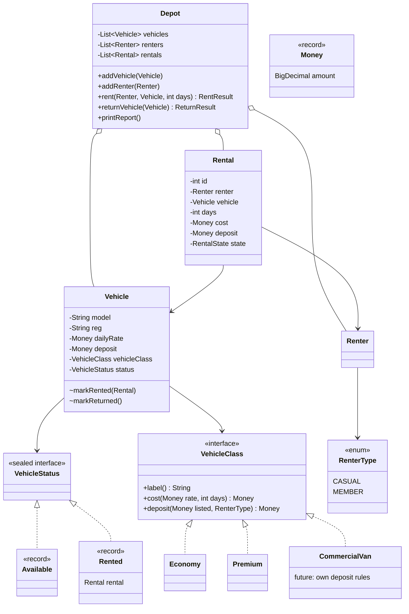

# DIAGNOSIS.md: Dovewing Car Rentals tracker

Written before any code change. Baseline behaviour is captured in `baseline-output.txt`.

## What the original does today

Running `RentalTracker` produces this (traced from the code):

```
Rented Toyota Vitz (GT-1234-20) to Kofi Mensah for 3 days, cost GHS 450.0, deposit GHS 500.0
Rented Toyota Prado (GR-5678-22) to Ama Owusu for 2 days, cost GHS 1200.0, deposit GHS 0.0
Returned Toyota Prado (GR-5678-22)
Rented Toyota Vitz (GT-1234-20) to Ama Owusu for 2 days, cost GHS 300.0, deposit GHS 0.0

=== Dovewing Car Rentals - end of day ===
Fleet status:
  Toyota Vitz (GT-1234-20, ECONOMY): RENTED
  Toyota Prado (GR-5678-22, PREMIUM): AVAILABLE
Active rentals:
  Rental #1: GT-1234-20 -> Kofi Mensah (3 days)
  Rental #3: GT-1234-20 -> Ama Owusu (2 days)
```

The bug is visible in the last block: one car, two active rentals, two different customers.

## Problems, ranked by danger to this business

### 1. A vehicle can be rented twice (MOST DANGEROUS)

- **Where:** `Depot.rent` never checks `v.status`. `Vehicle.status` is a public `String` that anyone can set.
- **Root cause:** "is this car free?" is stored in three unconnected places: `Vehicle.status`, each `Rental.status`, and the `rentals` list. Nothing keeps them consistent, so contradictory states are *representable*.
- **Risk:** A depot's whole product is "this car is yours on this date". Two customers arrive for one car: one goes home angry, and the depot may have taken two deposits. This is exactly why staff keep a paper backup.
- **Why it ranks first:** every other bug costs money or time; this one costs customers and trust, and the brief names it as the rule that must never be broken.

### 2. Returning a car corrupts the records

- **Where:** `returnVehicle` sets the car AVAILABLE and closes *every* active rental with that registration. It also never checks the car was rented.
- **Root cause:** same as #1. Status is not tied to *which* rental holds the car, so the code searches by registration string.
- **Risk:** With the double booking above, returning the Vitz for Kofi silently closes Ama's rental too. Returning an already-available car prints "Returned" and changes nothing, hiding a staff mistake.

### 3. Silent failures and no input validation

- **Where:** in `rent`, a category other than `"ECONOMY"`/`"PREMIUM"` (e.g. `"Premium"`) matches neither branch. The car is *not* marked rented, yet a rental is still recorded at cost 0 and deposit 0. `days` can be 0 or negative, giving zero or negative cost.
- **Root cause:** categories are free-text strings, and there is no `else` and no validation.
- **Risk:** A one-letter typo gives away a car for free with no error. Revenue leaks without anyone noticing.

### 4. Pricing rules are copy-pasted per vehicle category

- **Where:** the `ECONOMY` and `PREMIUM` branches in `rent` are line-for-line identical. Rate, deposit, member waiver and the printout are all duplicated.
- **Root cause:** behaviour that varies by class is expressed as `if/else` on a string instead of belonging to the class.
- **Risk:** This is the "premium tweak broke economy" story: edits to one copy and the shared surrounding code affect the other. The coming commercial-van class would be a third copy, plus edits anywhere else a category string is compared.

### 5. Everything is public and mutable

- **Where:** `Depot.vehicles` and `Depot.renters` are public lists; `getRentals()` returns the live internal list; `Rental.cost`, `Vehicle.dailyRate`, `Renter.history` etc. are public.
- **Root cause:** no encapsulation. Any code can edit a recorded price, remove a vehicle, or set a status.
- **Risk:** Even after #1 is fixed in `Depot`, callers could bypass it by writing `vehicle.status = "AVAILABLE"`. The rule is only safe if it cannot be bypassed.

### 6. Money as `double`

- **Where:** rates, costs and deposits are `double`.
- **Root cause:** binary floating point cannot represent decimal currency exactly.
- **Risk:** Rounding drift appears as soon as rates such as 149.99 or percentage discounts arrive. It is latent today (the current numbers happen to be exact).

### 7. Weak identity and shared global state

- **Where:** a `Rental` points to its renter by *name* and its vehicle by *registration string*. IDs come from `static int counter` shared across the whole JVM.
- **Root cause:** relationships are stored as copies of text rather than as references.
- **Risk:** Two renters with the same name are indistinguishable. A static counter cannot be reset between tests and is not thread-safe.

### Minor

- `rent` does not check that the renter is registered or the vehicle belongs to this depot.
- Business logic prints directly to the console, so it cannot be tested without capturing stdout.

## Design sketch (planned structure)



Key ideas:

- **One status per vehicle, as a sealed type.** `Available` or `Rented(rental)`. A car cannot be both, and a "rented" car always knows which rental holds it, so return no longer searches by string.
- **Only `Depot` can change status** (package-private mutators), and `Depot.rent` refuses a vehicle that is not `Available`.
- **Pricing and deposit rules live in a `VehicleClass`**, not in `if/else`. Adding a van means adding one class, with no edits to `Depot`.
- **Renter type is separate from vehicle class**, so deposit = f(vehicle class, renter type) and the two axes do not multiply into one branch per combination.
- **Defensive copies / unmodifiable views** for anything exposed from `Depot`.

## Intended behaviour change (the only one)

The final `d.rent(ama, vitz, 2)` call must now be **refused**: the Vitz is already out with Kofi. Everything else, including the output text and rental numbering for successful operations, should match the baseline above.
